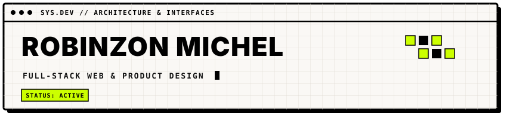

<!-- CABECERA BRUTALISTA CON ANIMACIÓN SVG -->

  

<!-- TAGS TÉCNICOS ESPECÍFICOS -->

  
  
  
  
  
  

---

### [ 01 ] SOBRE MÍ

> **INGENIERÍA WEB & SISTEMAS VISUALES**  
> Desarrollo aplicaciones completas enfocadas en arquitectura escalable, lógica de negocio robusta e interfaces gráficas con criterio editorial y funcional.

* **Stack:** Desarrollo web full-stack con React, Express y bases de datos relacionales (PostgreSQL).
* **Diseño:** Sistemas de diseño, geometría vectorial, prototipos e interfaces en Figma e Illustrator.
* **Enfoque:** Código limpio, consistencia tipográfica y alto desempeño.

---

### [ 02 ] HERRAMIENTAS & ENTORNO

<!-- Iconos monocromáticos limpios adaptados al contraste brutalista -->

  

---

### [ 03 ] REPOSITORIOS CLAVE

| Módulo | Tipo | Descripción | Tecnologías |
| :--- | :--- | :--- | :--- |
| **GridIt-Pro** | Tooling | Extensión de cuadrículas geométricas y guías de construcción | `JavaScript` `CEP` `Illustrator` |
| **SIGER-FMC** | Web App | Sistema integral para gestión técnica y flujo de servicios | `React` `Node.js` `PostgreSQL` |

---

### [ 04 ] ENLACES & CONTACTO

  
  &nbsp;&nbsp;
  

